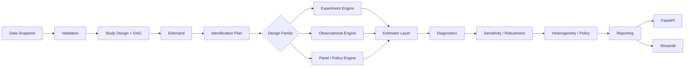

# CausalImpact Architecture

## High-level architecture



## Key application contracts

Conceptual interfaces:

```python
StudyDesignValidator.validate(design, data_contract)
Estimator.fit(data, design)
Estimator.estimate(estimand)
Diagnostic.run(fitted_analysis)
SensitivityAnalyzer.run(fitted_analysis)
ReportBuilder.build(analysis_run)
```

## Storage model

- SQLite: study/design/run metadata,
- Parquet: immutable analysis datasets / simulation outputs,
- artifact store: estimates, plots, diagnostics, reproducibility bundles.

## AnalysisRun

Must record enough metadata to reproduce the result:

- data version,
- study/design version,
- DAG / adjustment set,
- estimand,
- estimator,
- nuisance learners,
- formula/config,
- seed,
- inference config,
- diagnostics,
- artifact hashes.

## Domain model (`causalimpact.domain`)

- `StudyDesign` is a frozen, versioned record. Status changes and revisions return new
  objects; revisions happen only in Draft and bump `version` while keeping `design_id`.
- Promotion to `AnalysisReady` always runs a readiness check and fails closed by default.
- `AnalysisRun` is created only from an analyzable design via `AnalysisRun.for_design`,
  pins `design_id` + `design_version`, and must use the design's estimand, DAG version and
  adjustment-set version.
- Runs are never overwritten; a bad run moves to `Invalidated` with a reason.
- Estimands live in an `EstimandRegistry` (immutable per id). Estimators implement the
  `Estimator` protocol and declare `supported_estimands`; `run_estimator` refuses
  unsupported estimands and outputs that declare a different estimand.

## Reproducible identity

- Datasets: `causalimpact.ingestion.dataset_version` (content hash; row order significant).
- Designs: `StudyDesign.content_hash` (content only, not lifecycle).
- Runs: `AnalysisRun.fingerprint` identifies the specification; `run_id` one execution.
- Seeds: `derive_seed(root_seed, purpose)` gives independent, order-free child seeds.

## DAGs (`causalimpact.dags`)

- `CausalDAG` and `AdjustmentSet` versions are content hashes, so an AnalysisRun's stored
  `dag_version` / `adjustment_set_version` identify exactly what was assumed.
- `assess_adjustment_set` flags mediators, treatment descendants, declared colliders and
  unobserved variables, and checks the backdoor criterion by d-separation. It validates
  consistency with the declared DAG, never the DAG itself.

## Invariants

1. Design precedes estimation.
2. Estimand precedes estimator.
3. DAG/adjustment-set provenance is stored.
4. Numerical inference is deterministic code.
5. Failed diagnostics remain visible.
6. Flexible ML nuisance models do not bypass cross-fitting requirements when inference depends on it.
7. Dashboard/API contain no hidden causal math.
